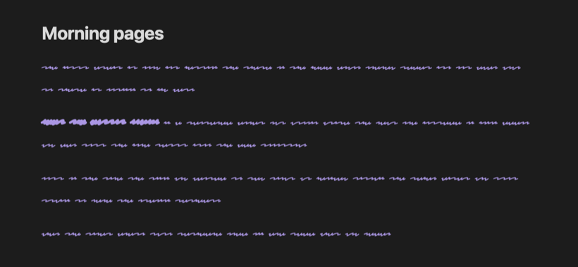

# Scribble Mode

Turn your note text into squiggles so you can write without stopping to reread or edit.



When you can read what you just wrote, it's hard not to fix it. Scribble Mode
hides your words as you type, which makes it useful for writing sprints,
morning pages and first drafts. Turn it off when you're done and everything is
back to normal. Your notes are never changed.

## Usage

**Everywhere:** run **Scribble Mode: Toggle on or off** from the command
palette, or click the pen icon in the ribbon. While it's on, **〰 Scribble**
shows in the status bar; click it to turn scribble mode off. You can give the
command a hotkey in **Settings → Hotkeys**.

**One note:** add `scribble` to the note's `cssclasses` property and that note
always shows as squiggles:

```yaml
---
cssclasses: scribble
---
```

Only the note body turns into squiggles. The note title, properties and the
rest of Obsidian stay readable, so you can still find your way around.
Word count, the cursor and selection all work as usual.

## Installation

Search for **Scribble Mode** in **Settings → Community plugins → Browse**.

To install it manually, download `main.js`, `manifest.json` and `styles.css`
from the [latest release](https://github.com/nickparkes7/obsidian-scribble-mode/releases/latest)
and put them in `<your vault>/.obsidian/plugins/scribble-mode/`.

## Development

```bash
npm install
npm run dev
```

`npm run dev` rebuilds `main.js` and `styles.css` as you edit. `npm run build`
makes a production build, and `npm run lint` runs the Obsidian ESLint rules.
The stylesheet is built from `src/styles.css`, with the fonts in `fonts/`
inlined as data URLs so the plugin works offline.

## Credits

Scribble Mode uses [Redacted Script](https://github.com/christiannaths/redacted-font)
by Christian Naths, licensed under the
[SIL Open Font License 1.1](fonts/OFL.txt). Inspired by the scribble font in
[Ellipsus](https://ellipsus.com).

## License

[MIT](LICENSE). The bundled font keeps its own license (see above).
